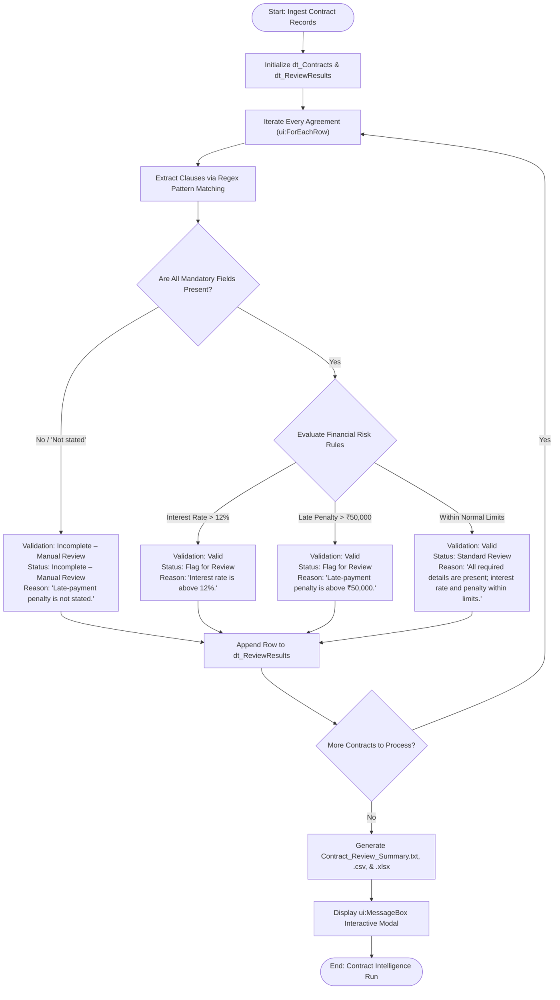

# Module 3 - Case Study 1: J.P. Morgan’s COIN Platform
## Practical Task: Intelligent Contract Review Using IPA

---

## 1. Executive Summary & Background
**J.P. Morgan's COIN (Contract Intelligence)** platform was developed to apply machine learning and natural language processing to legal agreements, notably analyzing commercial credit agreements and extracting thousands of critical data points and clauses in seconds—a task that previously consumed 360,000 attorney hours annually.

This practical simulation models an **Intelligent Process Automation (IPA)** workflow in **UiPath** that parses commercial loan agreements, extracts key credit clauses, validates required parameters, applies organizational risk assessment rules, and assigns review classifications with root-cause reasons.

---

## 2. Business Problem & Automation Scope
Financial institutions process substantial volumes of credit agreements daily. Manually reviewing every page to verify borrower terms, interest margins, repayment windows, and penalty covenants is time-intensive, expensive, and susceptible to cognitive fatigue.

### Extracted Field Specifications:
1. **Contract ID**: Unique loan identifier (e.g., `CON-101`)
2. **Borrower Name**: Legal name of borrowing party
3. **Loan Amount**: Principal sum sanctioned (e.g., `₹8,00,000`)
4. **Interest Rate**: Annual percentage rate (e.g., `9%`)
5. **Repayment Period**: Loan duration/tenure (e.g., `5 years`)
6. **Late-Payment Penalty**: Financial penalty covenant (e.g., `₹10,000`)

---

## 3. Workflow Architecture & Decision Flow

---

## 4. Evaluation Rules Matrix

| Rule Condition | Assigned Status | Validation Status | Review Reason |
| :--- | :--- | :--- | :--- |
| **Missing Field / "Not stated"** | `Incomplete – Manual Review` | `Incomplete – Manual Review` | *"Late-payment penalty is not stated."* |
| **Interest Rate > 12%** | `Flag for Review` | `Valid` | *"Interest rate is above 12%."* |
| **Late-Payment Penalty > ₹50,000** | `Flag for Review` | `Valid` | *"Late-payment penalty is above ₹50,000."* |
| **Compliant / Within Limits** | `Standard Review` | `Valid` | *"All required details are present; interest rate and penalty are within the illustrative limits."* |

---

## 5. Sample Contracts Tested

| Contract ID | Borrower | Loan Amount | Interest Rate | Repayment Period | Late-Payment Penalty | Review Status | Reason |
| :---: | :---: | :---: | :---: | :---: | :---: | :---: | :--- |
| **CON-101** | Asha Rao | ₹8,00,000 | 9% | 5 years | ₹10,000 | **Standard Review** | All required details are present; interest rate and penalty are within the illustrative limits. |
| **CON-102** | Kiran Shah | ₹15,00,000 | 14% | 7 years | ₹25,000 | **Flag for Review** | Interest rate is above 12%. |
| **CON-103** | Meera Das | ₹6,00,000 | 10% | 4 years | Not stated | **Incomplete – Manual Review** | Late-payment penalty is not stated. |

---

## 6. How to Open & Run in UiPath Studio
1. Open **UiPath Studio**.
2. Select **Open a Local Project** and choose [`COIN_Contract_Intelligence/project.json`](./project.json).
3. Open [`Main.xaml`](./Main.xaml) in Designer view.
4. Click **Run File** (or press `F5`).
5. Observe the automated parsing of all 3 agreements, file generations (`.txt`, `.csv`, `.xlsx`), and the summary modal dialog.
