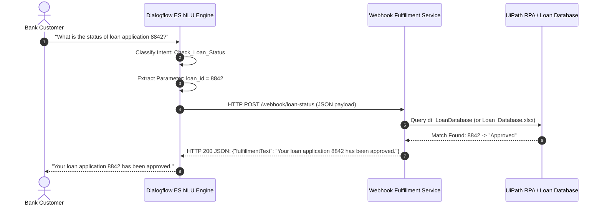

# Task 18: Dialogflow Chatbot with UiPath Integration for Loan Status Verification

## 1. Overview & Problem Statement
This project demonstrates an enterprise-grade **Chatbot-to-RPA Integration** workflow where:
1. **Google Dialogflow** handles natural language understanding (NLU), identifies the `Check_Loan_Status` intent, and extracts the target loan application ID (`loan_id`).
2. A **Webhook Fulfillment Engine** bridges Dialogflow and **UiPath RPA / Database** backend.
3. The RPA/database queries the loan records:
   - `8841` -> **Under Review**
   - `8842` -> **Approved**
   - `8843` -> **Rejected**
4. The chatbot responds with the tailored, real-time status message:
   - Primary test case (`8842`): *"Your loan application 8842 has been approved."*

---

## 2. End-to-End Chatbot-to-RPA Architecture



---

## 3. Sample Loan Database Records

The mock loan records stored in [`Loan_Database.csv`](./Loan_Database.csv) and [`Loan_Database.xlsx`](./Loan_Database.xlsx):

| Loan ID | Application Status | Chatbot Fulfillment Response |
| :---: | :---: | :--- |
| **8841** | **Under Review** | *"Your loan application 8841 is currently under review."* |
| **8842** | **Approved** | *"Your loan application 8842 has been approved."* |
| **8843** | **Rejected** | *"Your loan application 8843 has been rejected."* |
| *Other* | *NotFound* | *"Loan application {ID} was not found in the loan records. Please verify the application ID."* |

---

## 4. Webhook Payload Specifications

### 4.1 Dialogflow Webhook Request (JSON POST)
```json
{
  "responseId": "a1b2c3d4-e5f6-7890-abcd-1234567890ef",
  "queryResult": {
    "queryText": "What is the status of loan application 8842?",
    "action": "loan.check_status",
    "parameters": {
      "loan_id": "8842"
    },
    "allRequiredParamsPresent": true,
    "fulfillmentMessages": [
      {
        "text": {
          "text": [
            "Checking status for loan application 8842..."
          ]
        }
      }
    ],
    "intent": {
      "name": "projects/loan-status-agent/agent/intents/e1f2a3b4-0001-4000-8000-000000000001",
      "displayName": "Check_Loan_Status"
    },
    "intentDetectionConfidence": 1.0,
    "languageCode": "en"
  }
}
```

### 4.2 Webhook Fulfillment Response (JSON HTTP 200)
```json
{
  "fulfillmentText": "Your loan application 8842 has been approved.",
  "fulfillmentMessages": [
    {
      "text": {
        "text": [
          "Your loan application 8842 has been approved."
        ]
      }
    }
  ],
  "source": "UiPath-LoanStatus-RPA-Webhook"
}
```

---

## 5. Importing into Google Dialogflow Console
1. Open the [Google Dialogflow ES Console](https://dialogflow.cloud.google.com/).
2. Click **Create new agent** and name it `LoanStatusBot`.
3. Open **Settings** (gear icon) -> **Export and Import** tab.
4. Click **Restore from ZIP** and upload [`LoanStatusBot_Dialogflow_Export.zip`](./LoanStatusBot_Dialogflow_Export.zip).
5. Type **RESTORE** to confirm.
6. Under **Fulfillment** in the left menu:
   - Enable **Webhook**.
   - Enter your public webhook URL (e.g. from ngrok: `https://<your-subdomain>.ngrok-free.app/webhook/loan-status`).
   - Click **Save**.
7. In the right-hand **Try it now** panel, type:
   > *"What is the status of loan application 8842?"*
   
   The bot returns:
   > *"Your loan application 8842 has been approved."*

---

## 6. Running the Local Webhook Server
A zero-dependency Python fulfillment server is provided in [`webhook_service.py`](./webhook_service.py):
```bash
# Start server on default port 5000:
python3 webhook_service.py 5000

# Or execute self-test suite across all loan records:
python3 webhook_service.py test
```

---

## 7. UiPath RPA Orchestration Workflow (`Main.xaml`)
The UiPath project [`Main.xaml`](./Main.xaml) executes:
* Initializes `dt_LoanDatabase` with sample records.
* Ingests the query *"What is the status of loan application 8842?"*.
* Matches `loan_id` and looks up status in `dt_LoanDatabase`.
* Formats response string: `"Your loan application 8842 has been approved."`.
* Saves execution reports to `.txt`, `.csv`, and `.xlsx`.
* Displays interactive modal verification via `ui:MessageBox`.
