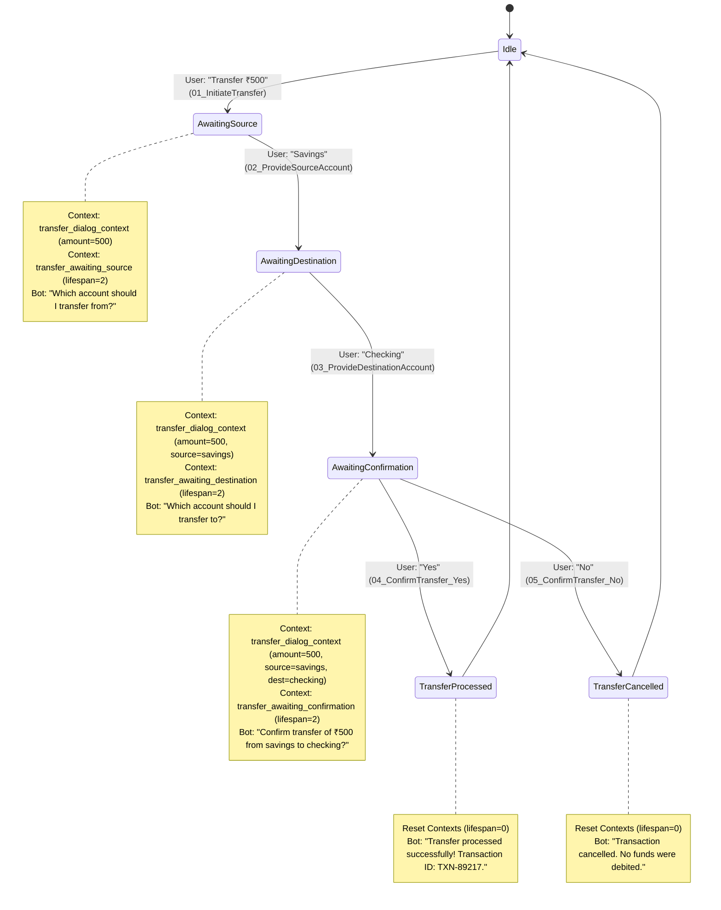

# Task 17: Dialogflow Multi-Turn Money Transfer Bot Implementation Guide

## 1. Overview & Problem Statement
In online banking workflows, financial transactions like money transfers require strict multi-turn state validation, accurate parameter preservation across turns, and a mandatory confirmation gate before committing any funds.

This project implements **MoneyTransferBot**, a specialized conversational agent built with **Google Dialogflow ES** and integrated with **UiPath Robotic Process Automation (RPA)**. The bot guides the user through collecting:
1. **Transfer Amount** (extracted via `@sys.number`)
2. **Source Account** (extracted via custom `@account_type` entity)
3. **Destination Account** (extracted via custom `@account_type` entity)
4. **Explicit Confirmation** (Yes/No authorization gate)

---

## 2. Conversation Flow & Dialogue State Machine



---

## 3. Dialogflow ES Context Architecture & Parameter Referencing

### 3.1 Long-lived Session Context vs. State Transition Contexts
Dialogflow ES manages state using two distinct types of contexts:
1. **Accumulator Context (`transfer_dialog_context`)**:
   - **Lifespan**: 10 turns.
   - **Purpose**: Holds all extracted parameters across turns (`amount`, `source_account`, `destination_account`).
2. **Transition Gating Contexts**:
   - `transfer_awaiting_source` (Lifespan: 2)
   - `transfer_awaiting_destination` (Lifespan: 2)
   - `transfer_awaiting_confirmation` (Lifespan: 2)
   - **Purpose**: Restricts intent activation so that answering an account name out-of-order will not trigger accidental transfers.

### 3.2 Cross-Turn Parameter Syntax
In Dialogflow ES text responses:
- Current intent parameters are accessed via `$parameter_name` (e.g. `$destination_account`).
- Parameters stored in previous turns via active contexts are accessed via `#context_name.parameter_name` (e.g. `#transfer_dialog_context.amount` and `#transfer_dialog_context.source_account`).

Hence, Intent 03's confirmation prompt is defined as:
```text
Confirm transfer of ₹#transfer_dialog_context.amount from #transfer_dialog_context.source_account to $destination_account?
```

---

## 4. Entity & Intent Specifications

### 4.1 Entity: `@account_type`
- **File**: `entities/account_type.json` & `account_type_entries_en.json`
- **Reference Values & Synonyms**:
  - `savings`: `savings`, `saving`, `savings account`, `salary account`
  - `checking`: `checking`, `current`, `checking account`, `current account`

### 4.2 Intent Hierarchy
| Intent Name | Input Context | Output Context | Parameters Extracted | Response Template |
| :--- | :--- | :--- | :--- | :--- |
| `01_InitiateTransfer` | None | `transfer_dialog_context` (10)<br>`transfer_awaiting_source` (2) | `amount` (`@sys.number`) | "Which account should I transfer from?" |
| `02_ProvideSourceAccount` | `transfer_awaiting_source` | `transfer_dialog_context` (10)<br>`transfer_awaiting_destination` (2) | `source_account` (`@account_type`) | "Which account should I transfer to?" |
| `03_ProvideDestinationAccount` | `transfer_awaiting_destination` | `transfer_dialog_context` (10)<br>`transfer_awaiting_confirmation` (2) | `destination_account` (`@account_type`) | "Confirm transfer of ₹#transfer_dialog_context.amount from #transfer_dialog_context.source_account to $destination_account?" |
| `04_ConfirmTransfer_Yes` | `transfer_awaiting_confirmation` | `transfer_dialog_context` (0)<br>`transfer_awaiting_confirmation` (0) | None | "Transfer of ₹#transfer_dialog_context.amount from #transfer_dialog_context.source_account to #transfer_dialog_context.destination_account has been processed successfully! Transaction ID: TXN-89217." |
| `05_ConfirmTransfer_No` | `transfer_awaiting_confirmation` | `transfer_dialog_context` (0)<br>`transfer_awaiting_confirmation` (0) | None | "Transfer of ₹#transfer_dialog_context.amount has been cancelled. No funds were debited." |

---

## 5. Importing into Dialogflow ES Console
1. Navigate to [Google Dialogflow ES Console](https://dialogflow.cloud.google.com/).
2. Click **Create new agent** and name it `MoneyTransferBot`.
3. Click the gear icon (Settings) next to the agent name.
4. Go to the **Export and Import** tab.
5. Click **Restore from ZIP** and upload `MoneyTransferBot_Dialogflow_Export.zip`.
6. Type **RESTORE** to confirm.
7. Use the right-hand **Try it now** panel to test the conversation!

---

## 6. UiPath RPA Orchestration Workflow
The UiPath project `Dialogflow_MoneyTransferBot` contains:
- `Main.xaml`: Automates the dialogue simulation, parsing turns, validating context states, and outputting formatted results to `.txt`, `.csv`, and `.xlsx`.
- `project.json`: Targets modern .NET 6/8 Windows framework.
