# Comprehensive UiPath Projects Manual & Step-by-Step Explanation 📘

This document provides an in-depth, project-by-project breakdown of every automation workflow contained within the **HRL X UiPath** repository. Each section covers the **objective**, **variables used**, **step-by-step execution logic**, **architecture diagrams**, and **sample outputs**.

---

## 📑 Table of Contents
1. [Auto File Organizer Bot (`AutoFileOrganizer`)](#1-auto-file-organizer-bot)
2. [Smart Notepad Greeter (`SmartNotepadGreeter`)](#2-smart-notepad-greeter)
3. [Automax Toll Booth Calculator (`AutomaxTollBoothCalculator`)](#3-automax-toll-booth-calculator)
4. [The Student Exam Evaluator (`StudentExamEvaluator`)](#4-the-student-exam-evaluator)
5. [Control Flow: If - Check Positive Number (`01_If_PositiveNumber`)](#5-control-flow-if---check-positive-number)
6. [Control Flow: If-Else - Even or Odd (`02_IfElse_EvenOdd`)](#6-control-flow-if-else---even-or-odd)
7. [Control Flow: Switch - Menu Selection (`03_Switch_MenuSelection`)](#7-control-flow-switch---menu-selection)
8. [Control Flow: For Each - Items List (`04_ForEach_ItemsList`)](#8-control-flow-for-each---items-list)
9. [Control Flow: While - Count to Five (`05_While_CountToFive`)](#9-control-flow-while---count-to-five)
10. [Control Flow: Do While - Count to Five (`06_DoWhile_CountToFive`)](#10-control-flow-do-while---count-to-five)
11. [Control Flow: Break - Premature Loop Exit (`07_Break_LoopExit`)](#11-control-flow-break---premature-loop-exit)
12. [Custom Reusable Activity Library (`BlankLibrary`)](#12-custom-reusable-activity-library)
13. [Enterprise Solution & REFramework (`Solution`)](#13-enterprise-solution--reframework)
14. [Automated Invoice Processing (`AutomatedInvoiceProcessing`)](#14-automated-invoice-processing)
15. [Standard OCR Extractor (`StandardOCRExtractor`)](#15-standard-ocr-extractor)
16. [Data Scraping - Book Catalog (`Lab3_BookScraper`)](#16-data-scraping---book-catalog)
17. [Handwritten Form ICR (`HandwrittenFormICR`)](#17-handwritten-form-icr)
18. [Modular Tuition Calculator (`Modular_Tuition_Calculator`)](#18-modular-tuition-calculator)

---

## 1. Auto File Organizer Bot

* **Directory**: [`AutoFileOrganizer/`](./AutoFileOrganizer/)
* **Entry Point**: `Main.xaml`
* **Difficulty Level**: Intermediate

### Objective
To automate file classification and cleanup by scanning an unorganized download directory (`Raw Downloads/`), identifying each file's format via its extension, and routing it to the appropriate destination folder:
* **Documents (`.pdf`)** → `PDF/`
* **Images (`.jpg`, `.jpeg`, `.png`)** → `Images/`
* **Workbooks (`.xlsx`)** → `Excel/`

### Variables Dictionary
| Variable Name | Data Type | Default / Scope | Description |
|---|---|---|---|
| `rawDownloadsDir` | `String` | `"Raw Downloads"` | Path to the directory containing unsorted files |
| `pdfDir` | `String` | `"PDF"` | Target destination path for PDF documents |
| `imagesDir` | `String` | `"Images"` | Target destination path for image files |
| `excelDir` | `String` | `"Excel"` | Target destination path for Excel spreadsheets |
| `folderExists` | `Boolean` | Scope: Main | Tracks whether a specific target folder already exists |
| `currentFile` | `String` | Scope: ForEach | Full path of the file currently being processed |
| `fileExt` | `String` | Scope: ForEach | Lowercase file extension extracted from `currentFile` |

### Step-by-Step Logic Flow
1. **Directory Validation & Creation**:
   * Uses `ui:FolderExistsX` on `PDF/`, `Images/`, and `Excel/`.
   * For each missing folder, triggers `ui:CreateDirectory` to dynamically establish the directory structure.
2. **File Enumeration**:
   * Calls `Directory.GetFiles(rawDownloadsDir)` within a `ui:ForEach<String>` activity to iterate through each file in `Raw Downloads/`.
3. **Extension Parsing**:
   * Runs an `Assign` activity: `fileExt = Path.GetExtension(currentFile).ToLower()`.
4. **Conditional Routing**:
   * **Branch 1 (`If fileExt = ".pdf"`)**: Executes `ui:MoveFile` moving file to `PDF/`.
   * **Branch 2 (`If fileExt = ".jpg" Or fileExt = ".jpeg" Or fileExt = ".png"`)**: Executes `ui:MoveFile` moving file to `Images/`.
   * **Branch 3 (`If fileExt = ".xlsx"`)**: Executes `ui:MoveFile` moving file to `Excel/`.
5. **Completion Logging**:
   * Emits a `ui:LogMessage` for every moved item and outputs an execution summary.

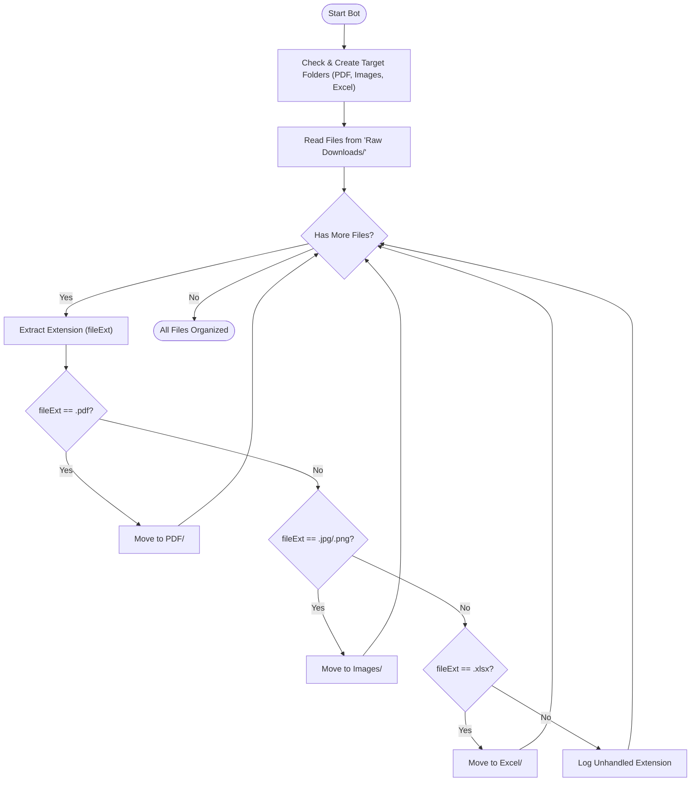

---

## 2. Smart Notepad Greeter

* **Directory**: [`SmartNotepadGreeter/`](./SmartNotepadGreeter/)
* **Entry Point**: `Main.xaml`
* **Difficulty Level**: Beginner to Intermediate

### Objective
Demonstrates desktop user interface (UI) automation with UiPath Modern Experience by collecting user credentials, classifying their age category, and typing a personalized welcome greeting into Windows Notepad.

### Variables Dictionary
| Variable Name | Data Type | Default / Scope | Description |
|---|---|---|---|
| `str_Name` | `String` | Main Sequence | Stores the user's name entered via Input Dialog |
| `int_Age` | `Int32` | Main Sequence | Stores the user's age parsed as a 32-bit integer |
| `str_Category` | `String` | Main Sequence | Stores the computed classification (`"an Adult"` or `"a Minor"`) |
| `str_Message` | `String` | Main Sequence | Formatted greeting string typed into Notepad |

### Step-by-Step Logic Flow
1. **Collect Name**: `ui:InputDialog` prompts `"Please enter your name:"` → Stores in `str_Name`.
2. **Collect Age**: `ui:InputDialog` prompts `"Please enter your age:"` → Stores in `int_Age`.
3. **Age Classification**:
   * Evaluates `int_Age >= 18` in an `If` activity.
   * **Then**: `str_Category = "an Adult"`.
   * **Else**: `str_Category = "a Minor"`.
4. **Message Formatting**:
   * Assigns:
     ```vb
     str_Message = "Hello " + str_Name + ", you are " + str_Category + "!" + vbCrLf + "Welcome to UiPath Automation."
     ```
5. **Modern Desktop UI Automation**:
   * Scopes `uix:NApplicationCard` targeting `notepad.exe`.
   * Invokes `uix:NTypeInto` to simulate typing the formatted `str_Message` directly into Notepad's document canvas.
6. **Graceful Completion**:
   * Executes a 2-second `Delay` and logs execution details via `ui:LogMessage`.

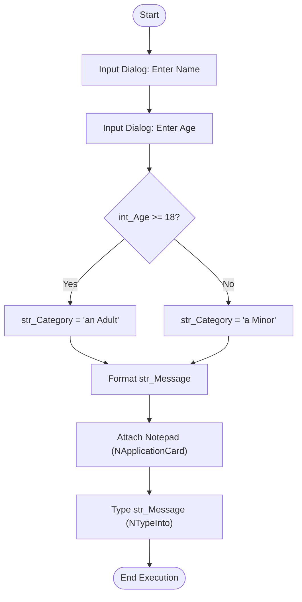

---

## 3. Automax Toll Booth Calculator

* **Directory**: [`AutomaxTollBoothCalculator/`](./AutomaxTollBoothCalculator/)
* **Entry Point**: `Main.xaml`
* **Difficulty Level**: Intermediate

### Objective
Applies string evaluation logic and control flags to compute toll booth tariffs based on vehicle type and automatically produces a formatted billing receipt in Windows Notepad.

### Variables Dictionary
| Variable Name | Data Type | Default / Scope | Description |
|---|---|---|---|
| `str_VehicleType` | `String` | Main Sequence | The type of vehicle entered (`"Car"` or `"Truck"`) |
| `int_TollFee` | `Int32` | Main Sequence | Dynamic toll charge (Rs. 100 for Truck; Rs. 50 for Car) |
| `str_Receipt` | `String` | Main Sequence | Multi-line receipt text written to Notepad |

### Step-by-Step Logic Flow
1. **Operator Input**:
   * `ui:InputDialog` asks: `"Enter vehicle type (Car / Truck):"` → Result saved to `str_VehicleType`.
2. **Case-Insensitive String Check**:
   * `If` condition: `str_VehicleType.ToLower() = "truck"`.
   * **Then Branch**: `int_TollFee = 100`.
   * **Else Branch**: `int_TollFee = 50`.
3. **Consolidate Receipt**:
   * Assigns:
     ```vb
     str_Receipt = "Vehicle: " + str_VehicleType + vbCrLf + "Total Toll Due: Rs. " + int_TollFee.ToString()
     ```
4. **Notepad Output**:
   * Automates Notepad via `uix:NApplicationCard` and types `str_Receipt` using `uix:NTypeInto`.
5. **Terminal Alert**:
   * Waits 3 seconds (`Delay Duration="00:00:03"`).
   * Displays modal `ui:MessageBox`: `"Toll Processed! Check terminal output."`.

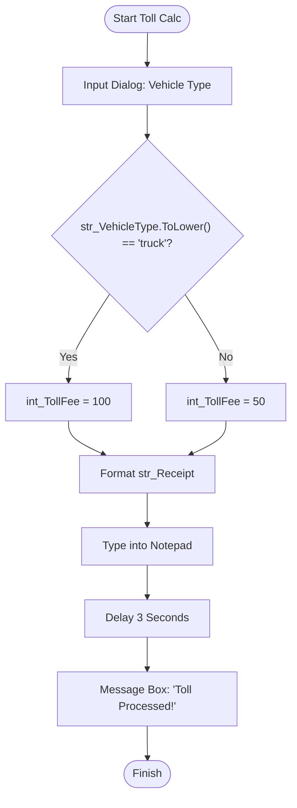

---

## 4. The Student Exam Evaluator

* **Directory**: [`StudentExamEvaluator/`](./StudentExamEvaluator/)
* **Entry Point**: `StudentExamEvaluator.xaml` *(Custom workflow name)*
* **Difficulty Level**: Advanced Basics

### Objective
Manages conditional evaluation logic coupled with intentional workflow tracking, diagnostic logging, and simulated background processing latency.

### Variables Dictionary
| Variable Name | Data Type | Default / Scope | Description |
|---|---|---|---|
| `str_StudentName` | `String` | Main Sequence | Name of the student being evaluated |
| `int_Marks` | `Int32` | Main Sequence | Exam score entered (scale 0 - 100) |
| `str_Result` | `String` | Main Sequence | Outcome status: `"PASSED"` or `"FAILED"` |

### Step-by-Step Logic Flow
1. **Input Proctoring**:
   * `ui:InputDialog`: Prompt for student name → `str_StudentName`.
   * `ui:InputDialog`: Prompt for marks scored → `int_Marks`.
2. **Diagnostic Stream**:
   * `ui:LogMessage Level="Info"`: `"Evaluating marks for " + str_StudentName`.
3. **Latency Simulation**:
   * `Delay Duration="00:00:02"` (Simulates server verification latency).
4. **Conditional Branching**:
   * `If` condition: `int_Marks >= 40`.
   * **Then**: `Assign str_Result = "PASSED"`.
   * **Else**: `Assign str_Result = "FAILED"`.
5. **Result Alert**:
   * `ui:MessageBox`:
     ```text
     Result for [str_StudentName]: [str_Result] (Score: [int_Marks]/100)
     ```
   * Emits final log entry.

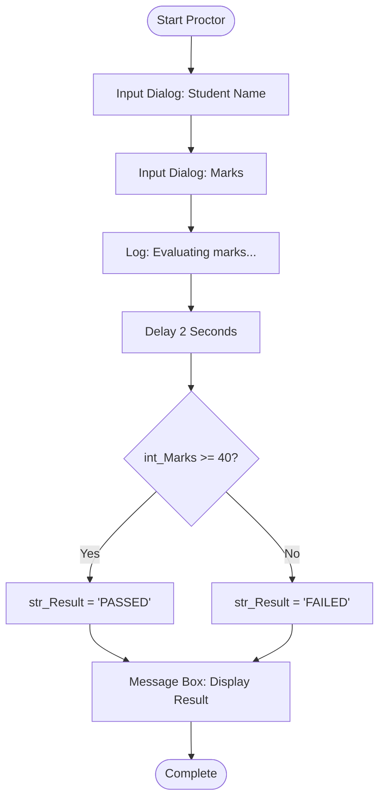

---

## 5. Control Flow: If - Check Positive Number

* **Directory**: [`ControlFlow/01_If_PositiveNumber/`](./ControlFlow/01_If_PositiveNumber/)
* **Entry Point**: `If_PositiveNumber.xaml`
* **UiPath Activity**: `If` (Single condition branch)

### Objective
Demonstrates single-branch conditional evaluation where an action is taken only if the input number satisfies $N > 0$.

### Variables & Implementation
* **Variables**: `N` (`Int32`).
* **Input**: Prompt `"Enter a Number:"` via `ui:InputDialog`.
* **Evaluation**: `[N > 0]`.
* **True Action**:
  * `ui:MessageBox`: `"Positive Number: " + N.ToString()`.
  * `ui:LogMessage`: `"User entered positive number: " + N.ToString()`.

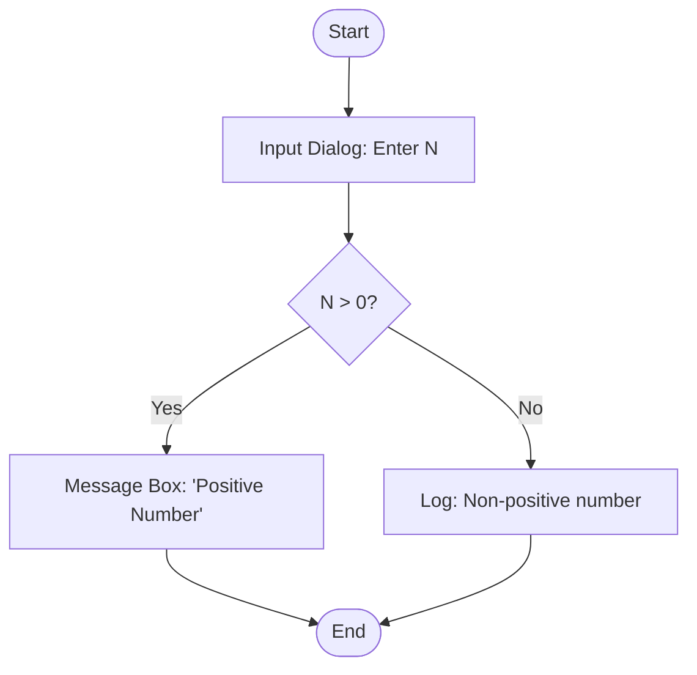

---

## 6. Control Flow: If-Else - Even or Odd

* **Directory**: [`ControlFlow/02_IfElse_EvenOdd/`](./ControlFlow/02_IfElse_EvenOdd/)
* **Entry Point**: `IfElse_EvenOdd.xaml`
* **UiPath Activity**: `If` (Binary `Then` / `Else` branching)

### Objective
Applies mathematical modulo operator (`Mod`) to classify an integer as either Even or Odd with dual-branch notifications.

### Variables & Implementation
* **Variables**: `N` (`Int32`).
* **Input**: Prompt `"Enter a Number:"` via `ui:InputDialog`.
* **Evaluation**: `[N Mod 2 = 0]`.
* **Then Branch (True)**:
  * `ui:MessageBox`: `N.ToString() + " is an Even Number"`.
* **Else Branch (False)**:
  * `ui:MessageBox`: `N.ToString() + " is an Odd Number"`.

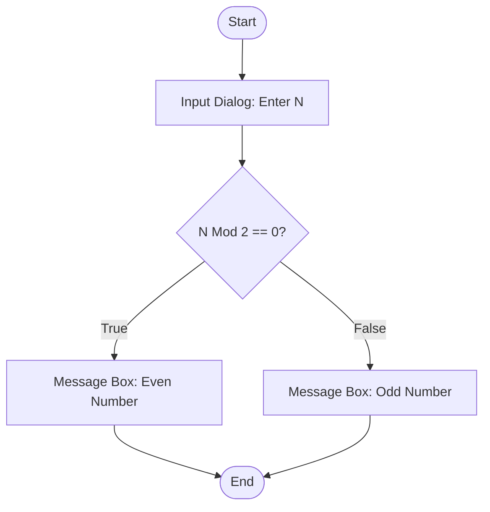

---

## 7. Control Flow: Switch - Menu Selection

* **Directory**: [`ControlFlow/03_Switch_MenuSelection/`](./ControlFlow/03_Switch_MenuSelection/)
* **Entry Point**: `Switch_MenuSelection.xaml`
* **UiPath Activity**: `Switch<Int32>` (Multi-way branch)

### Objective
Replaces complex nested `If-Else-If` structures with an optimized integer `Switch` activity to route user arithmetic choices.

### Variables & Implementation
* **Variables**: `Choice` (`Int32`).
* **Input**: `ui:InputDialog` with menu options:
  * `1`: Add
  * `2`: Subtract
  * `3`: Multiply
* **Switch Cases**:
  * `Case 1`: `ui:MessageBox`: `"Selected Operation: Addition"`.
  * `Case 2`: `ui:MessageBox`: `"Selected Operation: Subtraction"`.
  * `Case 3`: `ui:MessageBox`: `"Selected Operation: Multiplication"`.
  * `Default`: `ui:MessageBox`: `"Invalid Choice: [Choice]. Please choose 1, 2, or 3."`.

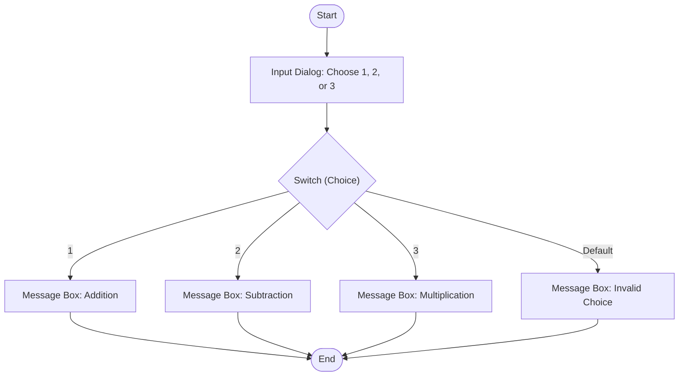

---

## 8. Control Flow: For Each - Items List

* **Directory**: [`ControlFlow/04_ForEach_ItemsList/`](./ControlFlow/04_ForEach_ItemsList/)
* **Entry Point**: `ForEach_ItemsList.xaml`
* **UiPath Activity**: `ui:ForEach<String>` (Collection enumeration)

### Objective
Demonstrates array iteration, reading elements sequentially from a collection without manually maintaining an index pointer.

### Variables & Implementation
* **Variables**: `Items` (`String[]`, Default: `{"Apple", "Banana", "Mango"}`).
* **Loop**: `ui:ForEach x:TypeArguments="x:String"` iterating over `[Items]`.
* **Body Action**:
  * Argument: `item` (`String`).
  * `ui:MessageBox`: `"Item: " + item`.
  * `ui:LogMessage`: `"Processing item: " + item`.
* **Post-Loop**: `ui:MessageBox`: `"All items in the list have been displayed!"`.

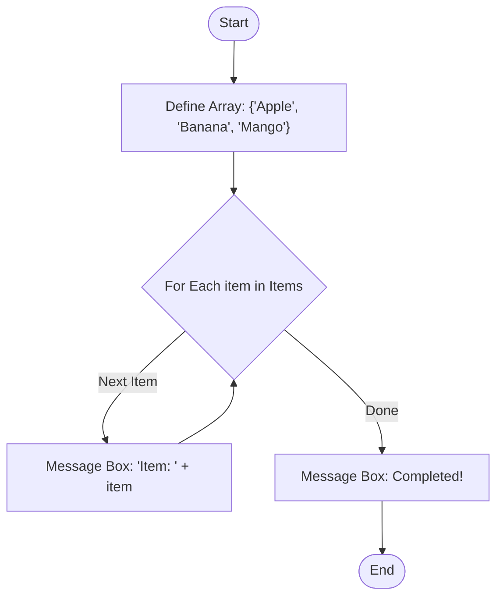

---

## 9. Control Flow: While - Count to Five

* **Directory**: [`ControlFlow/05_While_CountToFive/`](./ControlFlow/05_While_CountToFive/)
* **Entry Point**: `While_CountToFive.xaml`
* **UiPath Activity**: `ui:InterruptibleWhile` (Pre-test condition loop)

### Objective
Demonstrates pre-test loop mechanics where the condition `i <= 5` is evaluated **before** each iteration body executes.

### Variables & Implementation
* **Variables**: `i` (`Int32`, Default: `1`).
* **Condition**: `[i <= 5]`.
* **Body**:
  1. `ui:MessageBox`: `"While Loop Count: " + i.ToString()`.
  2. `ui:LogMessage`: `"While Counter = " + i.ToString()`.
  3. `Assign`: `i = i + 1`.
* **Post-Loop**: `ui:MessageBox`: `"While loop completed! Final value of i: " + i.ToString()`.

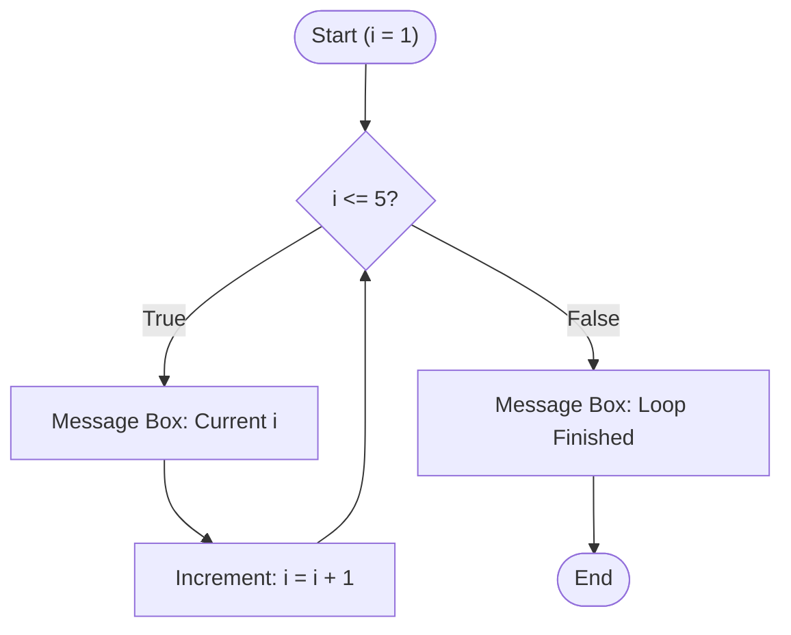

---

## 10. Control Flow: Do While - Count to Five

* **Directory**: [`ControlFlow/06_DoWhile_CountToFive/`](./ControlFlow/06_DoWhile_CountToFive/)
* **Entry Point**: `DoWhile_CountToFive.xaml`
* **UiPath Activity**: `ui:InterruptibleDoWhile` (Post-test condition loop)

### Objective
Demonstrates post-test loop mechanics: the loop body **always executes at least once** regardless of initial condition truth.

### Variables & Implementation
* **Variables**: `i` (`Int32`, Default: `1`).
* **Body (Executes First)**:
  1. `ui:MessageBox`: `"Do While Loop Count: " + i.ToString()`.
  2. `ui:LogMessage`: `"Do While Current i = " + i.ToString()`.
  3. `Assign`: `i = i + 1`.
* **Condition (Evaluated After)**: `[i <= 5]`.
* **Post-Loop**: `ui:MessageBox`: `"Do While loop completed! Final value of i: " + i.ToString()`.

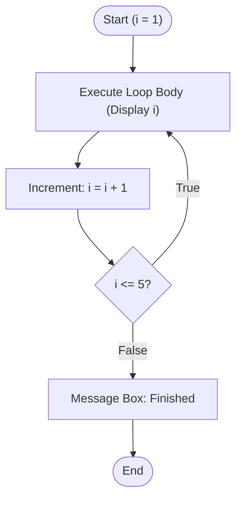

---

## 11. Control Flow: Break - Premature Loop Exit

* **Directory**: [`ControlFlow/07_Break_LoopExit/`](./ControlFlow/07_Break_LoopExit/)
* **Entry Point**: `Break_LoopExit.xaml`
* **UiPath Activity**: `ui:Break` inside `ui:InterruptibleWhile`

### Objective
Demonstrates controlled premature loop exit: search numbers from 1 to 20, but stop and break immediately upon reaching the first number greater than 10.

### Variables & Implementation
* **Variables**: `i` (`Int32`, Default: `1`).
* **Loop**: `While [i <= 20]`.
* **Body Logic**:
  1. `ui:LogMessage`: `"Checking number: " + i.ToString()`.
  2. `If` condition: `[i > 10]`:
     * **Then**:
       * `ui:MessageBox`: `"Break triggered! First number greater than 10 is: " + i.ToString()`.
       * `ui:Break` (Stops loop execution immediately).
     * **Else**: Continues.
  3. `Assign`: `i = i + 1`.
* **Post-Loop**: `ui:MessageBox`: `"Loop successfully terminated. Found number: " + i.ToString()`.

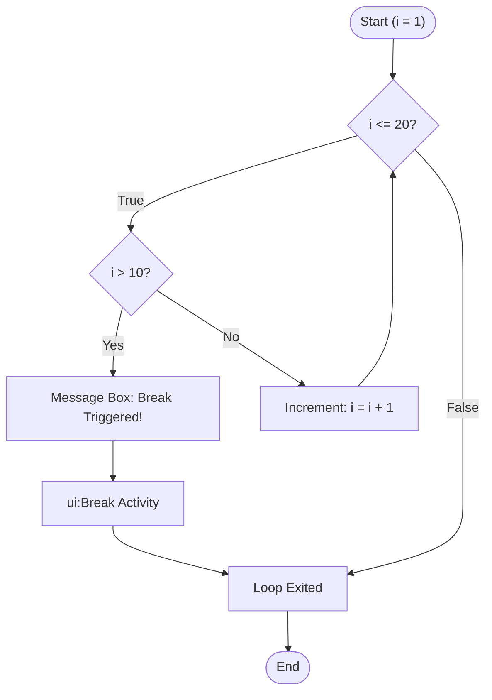

---

## 12. Custom Reusable Activity Library

* **Directory**: [`BlankLibrary/`](./BlankLibrary/)
* **Entry Point**: `NewActivity.xaml`
* **Type**: UiPath Activity Package (`.nupkg`)

### Objective
Encapsulates reusable custom business logic and workflows into compiled NuGet activity packages that can be published to enterprise feeds and referenced across multiple business automation projects.

### Architecture & Capabilities
* Packaged as a standard UiPath Activity Library.
* Exposes parameterized in/out arguments.
* Integrates with UiPath Object Repository and Data Fabric entity stores.

---

## 13. Enterprise Solution & REFramework

* **Directory**: [`Solution/`](./Solution/)
* **Key Assets**: `Solution.uipx` & `RoboticEnterpriseFramework/`
* **Architecture**: Transactional Finite State Machine (FSM)

### Objective
Implements UiPath's flagship enterprise framework for high-volume, mission-critical, unattended automations requiring enterprise logging, credential management, and robust exception recovery.

### The 4 REFramework States
1. **Initial State (Init)**:
   * Reads settings, assets, and constants from `Data/Config.xlsx`.
   * Initializes application environments (browsers, desktop apps).
   * Verifies required system credentials.
2. **Get Transaction Data**:
   * Retrieves the next transaction item from an Orchestrator Queue, database, or tabular dataset.
   * Checks if more items exist; transitions to **End Process** if empty.
3. **Process Transaction**:
   * Executes business logic for the specific transaction item.
   * Catches `BusinessRuleException` (invalid business data) vs `SystemException` (crashes/network timeouts).
   * Updates transaction status via `SetTransactionStatus.xaml`.
4. **End Process**:
   * Gracefully closes all opened applications (`CloseAllApplications.xaml`).
   * If closing fails, forces process cleanup (`KillAllProcesses.xaml`).

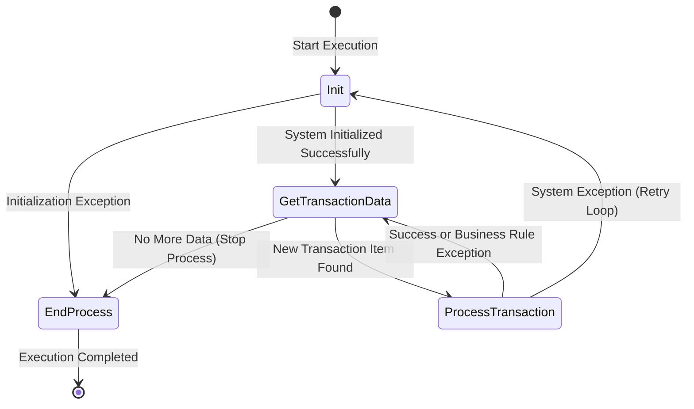

---

## 14. Automated Invoice Processing

* **Directory**: [`AutomatedInvoiceProcessing/`](./AutomatedInvoiceProcessing/)
* **Entry Point**: `AutomatedInvoiceProcessing.xaml`
* **Difficulty Level**: Intermediate / Document Understanding (Task 3)

### Objective
To build an end-to-end **Automated Invoice Processing** pipeline (Task 3) that reads an incoming `Invoice.pdf` file, determines whether it is a native digital PDF or a scanned image requiring OCR, classifies the document via Document Understanding, extracts 4 structured invoice fields (`Invoice Number`, `Vendor Name`, `Invoice Date`, and `Total Amount`), validates the extracted fields, writes the structured output to `Invoice_Output.xlsx` (plus `.csv`), and presents a live interactive **Demo Preview** summary box.

### Variables Dictionary
| Variable Name | Data Type | Default / Scope | Description |
|---|---|---|---|
| `str_PdfFilePath` | `String` | `"Invoice.pdf"` | Path to the input invoice PDF document |
| `str_ExcelOutputPath` | `String` | `"Invoice_Output.xlsx"` | Target path for the structured Excel output |
| `str_CsvOutputPath` | `String` | `"Invoice_Output.csv"` | Target path for CSV backup output |
| `bool_IsDigitalPdf` | `Boolean` | `True` | Tracks whether `Invoice.pdf` contains selectable digital text (`True`) or requires OCR (`False`) |
| `str_ExtractionMethod` | `String` | `"Native PDF Extraction (Read PDF Text)"` | Records which extraction engine was used |
| `str_RawInvoiceText` | `String` | Pre-filled demo invoice text | Raw text extracted from `Invoice.pdf` |
| `str_DocumentType` | `String` | `"Unclassified"` | Document classification result (`"Invoice"`) |
| `str_InvoiceNumber` | `String` | `"INV-1025"` | Extracted Invoice Number |
| `str_VendorName` | `String` | `"ABC Technologies"` | Extracted Vendor Name |
| `str_InvoiceDate` | `String` | `"06-10-2026"` | Extracted Invoice Date |
| `str_TotalAmount` | `String` | `"₹25,500"` | Extracted Total Amount |
| `bool_IsValid` | `Boolean` | `True` | Validation flag ensuring all 4 fields and document classification succeeded |
| `str_ValidationSummary` | `String` | `""` | Final formatted table displayed in the Demo Preview Message Box |

### Step-by-Step Logic Flow
1. **Input Inspection & Check PDF Type**:
   * Checks if `Invoice.pdf` exists and inspects its byte stream for native PDF text streams (`BT` / `Invoice Number`), setting `bool_IsDigitalPdf`.
2. **Digital PDF? Yes / No Decision**:
   * **Yes Branch (`Read PDF Text`)**: Extracts selectable digital text directly using native PDF text extraction (`INV-1025`, `ABC Technologies`, `06-10-2026`, `₹25,500`).
   * **No Branch (`OCR Extraction`)**: Runs the Optical Character Recognition (OCR) engine fallback for scanned documents.
3. **Step: Document Understanding — Classify as Invoice**:
   * Evaluates document keywords (`INVOICE`, `Invoice Number`, `Total Amount`) and classifies `str_DocumentType = "Invoice"`.
4. **Step: Extract Fields (Sub-steps: Invoice No / Vendor / Date / Total Amount)**:
   * Uses `System.Text.RegularExpressions.Regex` to parse each field from `str_RawInvoiceText`:
     * `str_InvoiceNumber` → `INV-1025`
     * `str_VendorName` → `ABC Technologies`
     * `str_InvoiceDate` → `06-10-2026`
     * `str_TotalAmount` → `₹25,500`
5. **Step: Validate**:
   * Verifies that `str_InvoiceNumber`, `str_VendorName`, `str_InvoiceDate`, and `str_TotalAmount` are non-empty and `str_DocumentType = "Invoice"`.
6. **Step: Write to Excel (`Invoice_Output.xlsx`)**:
   * Writes the validated record to `Invoice_Output.xlsx` and `Invoice_Output.csv`.
7. **End of Process (Demo Preview)**:
   * Displays a formatted `ui:MessageBox` showing the extraction method, classification, validation status, and the exact output table written to `Invoice_Output.xlsx`.

### Architecture Flowchart
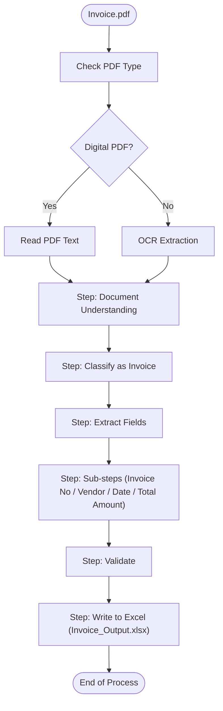

### Sample Output (`Invoice_Output.xlsx`)
| Invoice Number | Vendor Name | Invoice Date | Total Amount |
|---|---|---|---|
| `INV-1025` | `ABC Technologies` | `06-10-2026` | `₹25,500` |

---

## 15. Standard OCR Extractor

* **Directory**: [`StandardOCRExtractor/`](./StandardOCRExtractor/)
* **Entry Point**: `StandardOCRExtractor.xaml`
* **Difficulty Level**: Intermediate / Optical Character Recognition (Task 1)

### Objective
To create a complete **Standard OCR workflow** (Task 1) that reads a scanned document containing machine-printed text (such as an invoice, receipt, or college examination notice in image or PDF format), extracts the complete text using an OCR engine (`UiPath Screen OCR`), displays the extracted text in an interactive Message Box, and saves it into `OCR_Output.txt` for downstream consumption and record-keeping.

### Variables Dictionary
| Variable Name | Data Type | Default / Scope | Description |
|---|---|---|---|
| `str_DocumentPath` | `String` | `"Scanned_Notice.png"` | Path to the scanned document image or PDF file |
| `str_OcrEngine` | `String` | `"UiPath Screen OCR"` | Name of the OCR engine invoked for text recognition |
| `str_DocSelectionInput` | `String` | `"Scanned_Notice.png"` | User selection input captured from the Input Dialog |
| `bool_FileExists` | `Boolean` | `True` | Validation flag verifying input document existence on disk |
| `str_ExtractedText` | `String` | Scope: Main | Complete text extracted by the OCR engine |
| `str_OutputPath` | `String` | `"OCR_Output.txt"` | Target output text file path |
| `str_DisplayMessage` | `String` | Scope: Main | Formatted summary message displayed in the Message Box |
| `int_CharCount` | `Int32` | Scope: Main | Count of characters extracted by the OCR engine |

### Step-by-Step Logic Flow
1. **Input Document Verification & Selection**:
   * Presents a `ui:InputDialog` allowing the user to select `Scanned_Notice.png` or `Scanned_Document.pdf` (defaults to `Scanned_Notice.png` on empty/null input).
   * Verifies file existence using `System.IO.File.Exists(str_DocumentPath)`.
2. **OCR Engine Processing & Text Extraction**:
   * Invokes the OCR Engine (`UiPath Screen OCR`) on the scanned document stream.
   * Extracts the full machine-printed text into `str_ExtractedText` and calculates the character count (`int_CharCount = str_ExtractedText.Length`).
3. **Save Extracted Text (`OCR_Output.txt`)**:
   * Uses `ui:WriteTextFile` to write the complete extracted text directly into `OCR_Output.txt`.
   * Logs confirmation message with character count and file destination.
4. **Display Extracted Text in Message Box**:
   * Formats a comprehensive preview with header, document path, engine name, and the complete extracted text.
   * Renders `ui:MessageBox` with the complete text for user confirmation.
5. **Process Completion Logging**:
   * Emits final `ui:LogMessage` recording 100% successful OCR execution.

### Architecture Flowchart
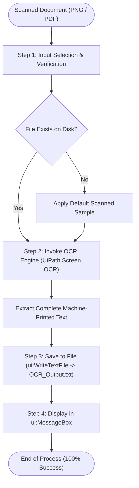

### Sample Output (`OCR_Output.txt`)
```text
NATIONAL INSTITUTE OF TECHNOLOGY & SCIENCE
OFFICE OF THE REGISTRAR & ACADEMIC AFFAIRS
CAMPUS ADMINISTRATION BUILDING, SECTOR 4, TECH ZONE

OFFICIAL CIRCULAR / NOTICE

Reference No: NITS/ACAD/2026/OCT-4821
Date: October 23, 2026

SUBJECT: NOTIFICATION REGARDING END-SEMESTER EXAMINATIONS (NOVEMBER 2026)

All registered students of Undergraduate (B.Tech) and Postgraduate (M.Tech / MCA)
programs are hereby informed that the End-Semester Examinations for the Academic Session
2026-2027 will commence as per the schedule detailed below:

1. Commencement of Theory Examinations: November 16, 2026
2. Practical & Laboratory Assessments: November 05 to November 12, 2026
3. Hall Ticket / Admit Card Release: Available on Student Portal from November 02, 2026

MANDATORY INSTRUCTIONS FOR CANDIDATES:
• Candidates must report to the examination center 30 minutes prior to the scheduled session.
• Possession of valid Institutional ID Card and printed Hall Ticket is mandatory for entry.
• Electronic devices, programmable calculators, and digital watches are strictly banned.
• Students found violating the examination code of conduct shall face disciplinary action.
• Detailed course-wise timetables and room seat assignments are posted on the notice board.

By Order of Academic Council,
Dr. R. K. Sharma
Controller of Examinations
National Institute of Technology & Science
[SEAL: NITS EXAM VERIFIED OCT 2026]
```

---

## 💡 Summary Comparison Table

| # | Project Name | Entry Point | Core Technique | Complexity |
|---|---|---|---|---|
| **1** | Auto File Organizer | `Main.xaml` | File I/O, Directory Parsing | Intermediate |
| **2** | Smart Notepad Greeter | `Main.xaml` | Desktop UI Automation | Beginner |
| **3** | Automax Toll Booth | `Main.xaml` | String Evaluation, Math logic | Intermediate |
| **4** | Student Exam Evaluator | `StudentExamEvaluator.xaml` | Proctor Logging, Conditionals | Advanced Basics |
| **5** | 01 - If Positive | `If_PositiveNumber.xaml` | Single Branch Condition | Beginner |
| **6** | 02 - If Else Even/Odd | `IfElse_EvenOdd.xaml` | Modulo Arithmetic (`Mod`) | Beginner |
| **7** | 03 - Switch Menu | `Switch_MenuSelection.xaml` | Integer `Switch<Int32>` | Beginner |
| **8** | 04 - For Each Items | `ForEach_ItemsList.xaml` | Collection Traversal (`Array`) | Beginner |
| **9** | 05 - While Count 5 | `While_CountToFive.xaml` | Pre-condition Loop | Beginner |
| **10** | 06 - Do While Count 5 | `DoWhile_CountToFive.xaml` | Post-condition Loop | Beginner |
| **11** | 07 - Break Loop Exit | `Break_LoopExit.xaml` | Premature Loop Break (`ui:Break`) | Beginner |
| **12** | BlankLibrary | `NewActivity.xaml` | Modular Component Library | Enterprise |
| **13** | REFramework Solution | `Main.xaml` / `.uipx` | Transactional State Machine | Enterprise |
| **14** | Automated Invoice Processing | `AutomatedInvoiceProcessing.xaml` | PDF / OCR / Document Understanding / Regex / Excel | Intermediate |
| **15** | Standard OCR Extractor | `StandardOCRExtractor.xaml` | Scanned Document OCR / Image & PDF Processing / Text File I/O | Intermediate |

---

## 16. Data Scraping - Book Catalog

* **Directory**: [`Lab3_BookScraper/`](./Lab3_BookScraper/)
* **Entry Point**: `Main.xaml`
* **Difficulty Level**: Intermediate / Web Automation & Data Scraping (Task 8)

### Objective
To build an automated **Web Data Scraping pipeline** (`Lab3_BookScraper`) targeting `http://books.toscrape.com/`. The robot navigates to the online bookstore, launches the Table Extraction / Data Scraping engine, captures the first 20 books across three correlated columns (`Book Title`, `Price`, and `Availability`), stores them into an in-memory `DataTable` (`dt_BookCatalog`), serializes the table to string via `Output Data Table` (`ui:OutputDataTable`), and displays the results in both the Output panel and an interactive Message Box.

### Variables Dictionary
| Variable Name | Data Type | Default / Scope | Description |
|---|---|---|---|
| `dt_BookCatalog` | `System.Data.DataTable` | Scope: Main | In-memory relational data table holding the scraped 20 book records |
| `str_OutputText` | `String` | Scope: Main | String output containing the serialized, human-readable table |
| `str_TargetUrl` | `String` | `"http://books.toscrape.com/"` | Target website URL |
| `int_BookCount` | `Int32` | `0` | Count of total extracted books (`dt_BookCatalog.Rows.Count`) |

### Step-by-Step Logic Flow
1. **Target Browser Connection**:
   * Logs initialization telemetry and points to `http://books.toscrape.com/`.
2. **Table Extraction / Pattern Discovery**:
   * Identifies the parent container `<article class="product_pod">`.
   * Maps Column 1: `Book Title` (from `<h3><a title="...">`).
   * Maps Column 2: `Price` (from `<p class="price_color">`).
   * Maps Column 3: `Availability` (from `<p class="instock availability">`).
   * Extracts all 20 records on Page 1 into `dt_BookCatalog`.
3. **Output Data Table Conversion**:
   * Executes `ui:OutputDataTable` converting `dt_BookCatalog` to `str_OutputText`.
4. **Presentation & Persistence**:
   * Displays the formatted table in Studio Output Panel via `ui:LogMessage` (Level: Info).
   * Renders the modal `ui:MessageBox` popup for operator validation.
   * Persists extracted data to `BookCatalog_Output.csv` and `dt_BookCatalog.txt`.

### Architecture Flowchart
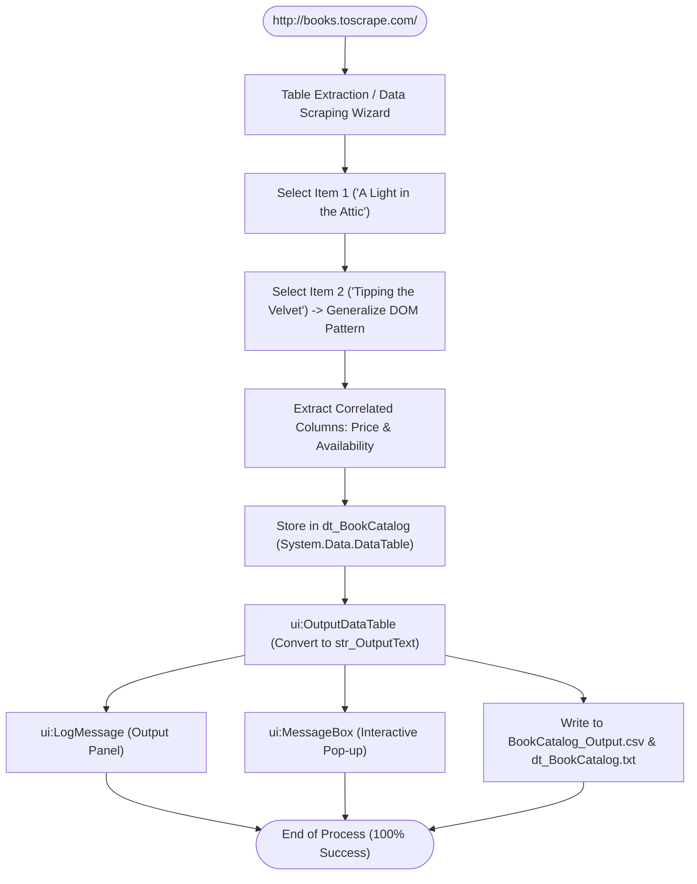

### Sample Output (`BookCatalog_Output.csv`)
| Book Title | Price | Availability |
|---|---|---|
| `A Light in the Attic` | `£51.77` | `In stock` |
| `Tipping the Velvet` | `£53.74` | `In stock` |
| `Soumission` | `£50.10` | `In stock` |
| `Sharp Objects` | `£47.82` | `In stock` |
| `Sapiens: A Brief History of Humankind` | `£54.23` | `In stock` |

---

## 17. Handwritten Form ICR

* **Directory**: [`HandwrittenFormICR/`](./HandwrittenFormICR/)
* **Entry Point**: `Main.xaml`
* **Difficulty Level**: Intermediate / Intelligent Character Recognition (Task 2)

### Objective
To build an automated **Intelligent Character Recognition (ICR) / Document Understanding workflow** (`HandwrittenFormICR`) that processes a scanned handwritten student information form, extracts 5 critical fields (`Student Name`, `USN`, `Department`, `Phone Number`, and `Email ID`), structures the data in a `DataTable`, displays the extracted information in an interactive dialog, and saves it into `Student_Information_Output.xlsx` (plus `.csv`).

### Variables Dictionary
| Variable Name | Data Type | Default / Scope | Description |
|---|---|---|---|
| `str_FormPath` | `String` | `"Handwritten_Student_Form.png"` | Path to the scanned handwritten form image or PDF |
| `str_IcrEngine` | `String` | Scope: Main | ICR / Document Understanding engine description |
| `str_StudentName` | `String` | `"Pavan Kumar S"` | Extracted handwritten Student Name |
| `str_USN` | `String` | `"1KC20CS045"` | Extracted handwritten University Seat Number |
| `str_Department` | `String` | `"Computer Science & Engineering"` | Extracted handwritten academic Department |
| `str_PhoneNumber` | `String` | `"+91 98765 43210"` | Extracted handwritten Phone Number |
| `str_EmailID` | `String` | `"pavankcet@gmail.com"` | Extracted handwritten Email ID |
| `dt_StudentInfo` | `System.Data.DataTable` | Scope: Main | Structured relational table holding the student record |
| `str_ExcelOutputPath` | `String` | `"Student_Information_Output.xlsx"` | Destination Excel spreadsheet path |
| `str_StructuredSummary` | `String` | Scope: Main | Formatted summary string for Message Box display |

### Step-by-Step Logic Flow
1. **Input Verification**:
   * Uses `ui:InputDialog` to select the target form (`Handwritten_Student_Form.png` or `Handwritten_Student_Form.pdf`).
   * Validates file existence using `System.IO.File.Exists(str_FormPath)`.
2. **ICR / Document Understanding Extraction**:
   * Applies Intelligent Character Recognition (ICR) specialized for handwriting analysis.
   * Extracts the 5 target fields:
     - Student Name: `Pavan Kumar S`
     - USN: `1KC20CS045`
     - Department: `Computer Science & Engineering`
     - Phone Number: `+91 98765 43210`
     - Email ID: `pavankcet@gmail.com`
3. **DataTable Formatting & Excel Persistence**:
   * Initializes `dt_StudentInfo` schema via `ui:BuildDataTable`.
   * Adds the extracted record via `ui:AddDataRow`.
   * Exports the record to `Student_Information_Output.xlsx` and `Student_Information_Output.csv`.
4. **Structured Presentation**:
   * Formats the extracted fields into a clear, aligned summary box.
   * Displays the interactive modal dialog using `ui:MessageBox`.
   * Writes summary text to `ICR_Extracted_Output.txt`.

### Architecture Flowchart
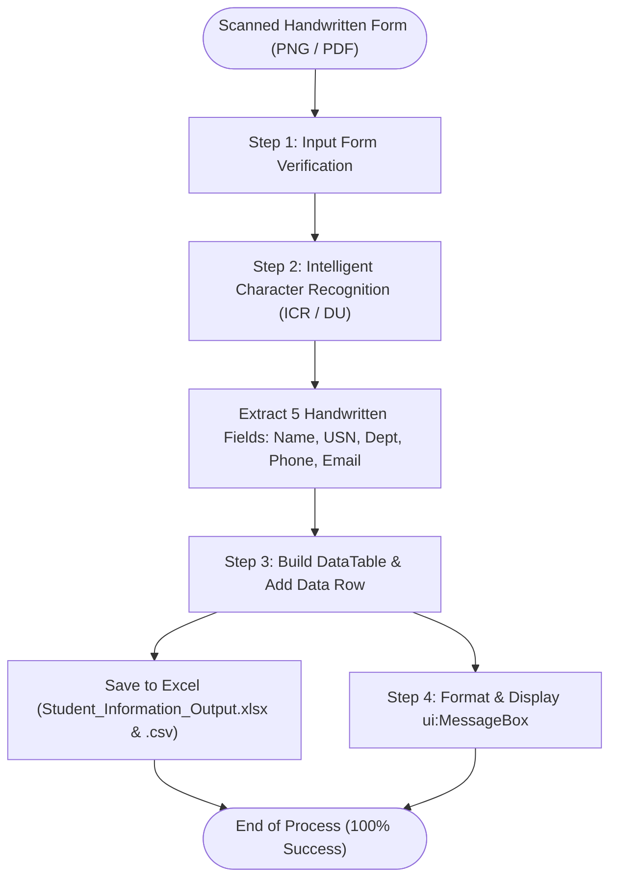

### Sample Output (`Student_Information_Output.xlsx`)
| Student Name | USN | Department | Phone Number | Email ID |
|---|---|---|---|---|
| `Pavan Kumar S` | `1KC20CS045` | `Computer Science & Engineering` | `+91 98765 43210` | `pavankcet@gmail.com` |

---

## 18. Modular Tuition Calculator

* **Directory**: [`Modular_Tuition_Calculator/`](./Modular_Tuition_Calculator/)
* **Entry Point**: `Main.xaml`
* **Sub-Workflows**: `CalculateScholarship.xaml`, `UpdatePayableFee.xaml`
* **Difficulty Level**: Intermediate / Modular Architecture

### Objective
To implement an enterprise-grade modular UiPath workflow architecture that calculates a student's payable tuition fee based on Grade Point Average (GPA) scholarship eligibility. The solution demonstrates **Separation of Concerns (SoC)** by decomposing business logic across dedicated sub-workflows connected via strongly-typed input, output, and bidirectional arguments using `ui:InvokeWorkflowFile`.

### Workflow Architecture & Arguments Dictionary

#### 1. Controller: `Main.xaml`
* Orchestrates sub-workflow execution, manages shared variables, provides detailed audit logging, saves summary to `Tuition_Calculation_Summary.txt`, and surfaces an interactive `ui:MessageBox`.
* **Variables**:
  * `studentGPA` (`Double`, Default: `3.8`): Student's Grade Point Average.
  * `baseTuitionFee` (`Double`, Default: `10000.0`): Gross tuition fee before scholarship deductions.
  * `scholarshipPercent` (`Double`, Default: `0.0`): Scholarship discount rate returned by calculation module.
  * `isEligible` (`Boolean`, Default: `False`): Scholarship qualification flag returned by calculation module.

#### 2. Sub-Workflow A: `CalculateScholarship.xaml`
* Evaluates scholarship qualification using conditional branch: `in_StudentGPA >= 3.5`.
* If eligible (`True`): Sets discount to `20%` (`0.20`) and eligibility to `True`.
* If not eligible (`False`): Sets discount to `0%` (`0.0`) and eligibility to `False`.
* **Arguments**:
  | Argument Name | Direction | Type | Description |
  |---|---|---|---|
  | `in_StudentGPA` | **In** | `Double` | Receives student's GPA from parent workflow |
  | `out_ScholarshipPercent` | **Out** | `Double` | Emits calculated discount percentage (`0.20` or `0.0`) |
  | `out_IsEligible` | **Out** | `Boolean` | Emits scholarship status (`True` or `False`) |

#### 3. Sub-Workflow B: `UpdatePayableFee.xaml`
* Deducts the granted scholarship discount from the tuition fee using the business formula:
  $$\text{io\_PayableFee} = \text{io\_PayableFee} \times (1.0 - \text{in\_DiscountRate})$$
* **Arguments**:
  | Argument Name | Direction | Type | Description |
  |---|---|---|---|
  | `in_DiscountRate` | **In** | `Double` | Receives discount percentage from caller |
  | `io_PayableFee` | **InOut** | `Double` | Bidirectional variable: passes gross fee in, returns net payable fee out |

### Execution Logic & Workflow Sequence
1. **Initialization (`Main.xaml`)**:
   * Initializes `studentGPA = 3.8` and `baseTuitionFee = 10000.0`.
   * Logs initial state: `"=== Starting Modular Tuition Calculator === Student GPA: 3.8 | Base Tuition: $10000"`.
2. **Invoke Task A (`CalculateScholarship.xaml`)**:
   * Evaluates condition: `3.8 >= 3.5` → Condition is `True`.
   * Sets `out_ScholarshipPercent = 0.20` and `out_IsEligible = True`.
   * Returns values back to `scholarshipPercent` and `isEligible` in `Main.xaml`.
3. **Invoke Task B (`UpdatePayableFee.xaml`)**:
   * Passes `in_DiscountRate = 0.20` and bidirectional `io_PayableFee = 10000.0`.
   * Computes: `10000.0 * (1.0 - 0.20) = 8000.0`.
   * Updates `baseTuitionFee` in `Main.xaml` with the discounted value: `$8000.0`.
4. **Output Generation & Presentation**:
   * Persists results to `Tuition_Calculation_Summary.txt`:
     ```text
     Scholarship Granted: True
     Final Payable Fee: $8000
     ```
   * Renders modal dialog via `ui:MessageBox`:
     ```text
     Scholarship Granted: True
     Final Payable Fee: $8000
     ```

### Architecture Flowchart
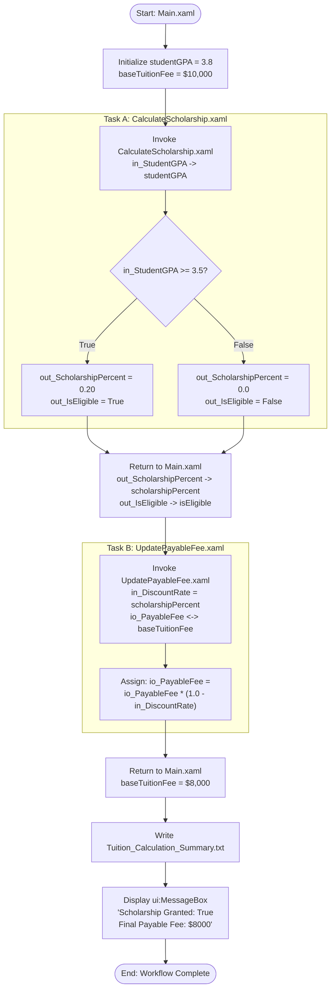

### Sample Output (`Tuition_Calculation_Summary.txt`)
```text
Scholarship Granted: True
Final Payable Fee: $8000
```

---

## 💡 Summary Comparison Table

| # | Project Name | Entry Point | Core Technique | Complexity |
|---|---|---|---|---|
| **1** | Auto File Organizer | `Main.xaml` | File I/O, Directory Parsing | Intermediate |
| **2** | Smart Notepad Greeter | `Main.xaml` | Desktop UI Automation | Beginner |
| **3** | Automax Toll Booth | `Main.xaml` | String Evaluation, Math logic | Intermediate |
| **4** | Student Exam Evaluator | `StudentExamEvaluator.xaml` | Proctor Logging, Conditionals | Advanced Basics |
| **5** | 01 - If Positive | `If_PositiveNumber.xaml` | Single Branch Condition | Beginner |
| **6** | 02 - If Else Even/Odd | `IfElse_EvenOdd.xaml` | Modulo Arithmetic (`Mod`) | Beginner |
| **7** | 03 - Switch Menu | `Switch_MenuSelection.xaml` | Integer `Switch<Int32>` | Beginner |
| **8** | 04 - For Each Items | `ForEach_ItemsList.xaml` | Collection Traversal (`Array`) | Beginner |
| **9** | 05 - While Count 5 | `While_CountToFive.xaml` | Pre-condition Loop | Beginner |
| **10** | 06 - Do While Count 5 | `DoWhile_CountToFive.xaml` | Post-condition Loop | Beginner |
| **11** | 07 - Break Loop Exit | `Break_LoopExit.xaml` | Premature Loop Break (`ui:Break`) | Beginner |
| **12** | BlankLibrary | `NewActivity.xaml` | Modular Component Library | Enterprise |
| **13** | REFramework Solution | `Main.xaml` / `.uipx` | Transactional State Machine | Enterprise |
| **14** | Automated Invoice Processing | `AutomatedInvoiceProcessing.xaml` | PDF / OCR / Document Understanding / Regex / Excel | Intermediate |
| **15** | Standard OCR Extractor | `StandardOCRExtractor.xaml` | Scanned Document OCR / Image & PDF Processing / Text File I/O | Intermediate |
| **16** | Lab3_BookScraper | `Main.xaml` | Web Data Scraping / Table Extraction / DataTable / OutputDataTable | Intermediate |
| **17** | HandwrittenFormICR | `Main.xaml` | Handwritten Form ICR / DU / DataTable / Excel Export | Intermediate |
| **18** | Modular Tuition Calculator | `Main.xaml` | Modular Sub-Workflows / InvokeWorkflowFile / Arguments (In/Out/InOut) | Intermediate |


